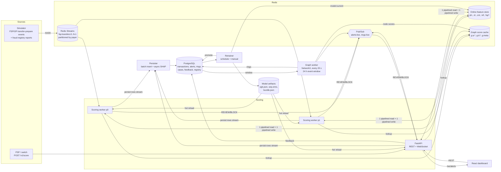

# Architecture

> **Scope note.** Events are *Mojaloop-style simulated* transfers (FSPIOP transfer-prepare messages generated from a
> synthetic dataset). There is **no live Mojaloop integration**; `pipeline/mojaloop_adapter.py` is the seam where a
> real Mojaloop sandbox (central-ledger Kafka topic or FSPIOP callbacks) would be plugged in.

## Components

## Data flow per transfer

1. **Ingest.** The simulator (or a real switch adapter) publishes a Mojaloop transfer-prepare message to stream
   partition `crc32(payer) % N`. Partitioning by payer keeps each payer's events in order on one worker, like Kafka
   partitions. Fraud-registry reports travel on the same stream.
2. **Map.** `from_fspiop()` decodes the (mocked) ILP packet's Transaction object and the `extensionList` (device,
   IP, geo, channel, device-binding time) into the internal schema.
3. **Score** (`pipeline/scorer.py`):
   1. **One** pipelined Redis round trip: idempotency key `idem:<transferId>`, every feature-state read, graph-score
      lookups for payer/payee/device, and graph freshness (`g:meta`).
   2. Feature computation with the shared `FeatureEngine` (pure Python).
   3. XGBoost margin (`inplace_predict`, 1 thread).
   4. Sequence model: ONNX Runtime, batch 1, warmed up at load. It runs in a worker thread with a
      `SEQUENCE_TIMEOUT_MS` deadline; on timeout or error it falls back.
   5. Graph component: cached node scores. If the graph worker hasn't refreshed within `GRAPH_STALE_AFTER_S`, it
      falls back.
   6. Stacked logistic meta-learner. The **combo** is chosen by component availability: `full`, `xgb_seq`,
      `xgb_graph` or `xgb`. Any fallback sets `degraded=true` with the reasons.
   7. Decision against that combo's calibrated REVIEW/BLOCK thresholds.
   8. SHAP: computed synchronously for REVIEW/BLOCK (top 5 reasons in the response). For ALLOW it goes to a
      background thread, and on-demand from `/explanation` if the queue was full.
   9. **One** pipelined Redis round trip for writes: state updates, idempotency record (24 h), latency/throughput
      metrics, and the alert publish.
4. **Persist.** After the decision, the scorer appends the scored row (and any alert) to the Redis stream
   `persist:rows` in one small pipeline. The **persister** process (`pipeline/persister.py`) batch-inserts the rows
   into PostgreSQL and computes the asynchronous ALLOW-path SHAP explanations, so database work never competes with
   scoring for the worker's GIL. A PostgreSQL outage just leaves rows pending in Redis (bounded at 200k); if Redis
   itself is down, the scorer falls back to an in-process buffered writer with disk spooling.
5. **Graph** (`graph/worker.py`). Every `GRAPH_INTERVAL_S` it loads the trailing 24 h event window, runs five
   detectors, keeps ring ids stable, and replaces the Redis node-score hashes. It upserts rings with score ≥ 0.5 to
   Postgres and pushes them to the dashboard.
6. **Operators** work alerts, cases and feedback in the dashboard. Each label is stored with operator id and
   timestamp. A *True Fraud* label also feeds the counterparty-risk registry (`cnt:<payee>.rep`, `reported` set).
7. **Retraining.** It runs on a schedule (`RETRAIN_INTERVAL_HOURS` and ≥ `RETRAIN_MIN_FEEDBACK` new labels) or on
   `POST /v1/models/retrain`. Feedback overrides labels; the candidate is gated on the held-out window; a promotion
   updates the registry and `model:current`; workers hot-swap the model within `MODEL_POLL_INTERVAL_S`.

## Latency budget (target p99 < 100 ms per transfer)

Budget per stage versus what was measured. Measurements come from `components.timings_ms`, stored with each of
84,000 stream-scored transfers in the final benchmark run (200 TPS and 1000 TPS phases; `docs/latency_breakdown.json`).
End-to-end results are in `docs/results.md` / `docs/benchmarks.json`.

| Stage | Budget | Measured p50 / p99 | How it is kept small |
|---|---|---|---|
| Feature fetch (Redis round trip #1) | 10 ms | 1.62 / 6.29 ms | ~25 commands in one non-transactional pipeline; no per-feature round trips |
| Feature compute | 5 ms | 0.31 / 0.57 ms | Pure Python over ≤ 50 history entries; no pandas on the hot path |
| XGBoost | 5 ms | 0.78 / 1.85 ms | `inplace_predict` on a NumPy row, single thread |
| Sequence model | 25 ms (hard timeout) | 0.32 / 0.84 ms | ONNX Runtime, batch 1, one intra-op thread, warmed up; timeout → `xgb_graph` combo |
| Graph lookup + meta-learner + decision | 1 ms | 0.08 / 0.19 ms | Graph scores are part of round trip #1 (cached by the async graph worker); linear meta-learner |
| SHAP (REVIEW/BLOCK only) | 10 ms | 5.51 / 10.97 ms (236 alerts) | TreeExplainer on one row + plain-language reasons; ALLOW explanations are asynchronous (persister) |
| State write (Redis round trip #2) | 10 ms | 1.26 / 6.00 ms | One pipeline (updates + idempotency + counters + alert publish) |
| **Total scoring latency** | **≤ 66 ms** | **4.56 / 14.30 ms** | |
| Persistence enqueue + latency sample | off the clock | — | Separate small pipeline after the decision; PostgreSQL writes happen in the persister process |

## Failure modes and behaviour

| Failure | Detection | Behaviour |
|---|---|---|
| Sequence model slow or failing | future timeout / exception | `xgb_graph` (or `xgb`) combo, `degraded=true`, reason `sequence_timeout` / `sequence_error` |
| Graph worker stalled | `g:meta.wall` older than `GRAPH_STALE_AFTER_S` | `xgb_seq` / `xgb` combo, reason `graph_stale` |
| Redis unavailable | exception on round trip #1 | score with cold-start state (stateless features), reason `feature_store_unavailable`; no state write |
| PostgreSQL unavailable | persister write exception | scoring continues; rows stay unacknowledged in the `persist:rows` stream and are retried with backoff |
| Duplicate delivery | `idem:<transferId>` hit, DB primary key | cached decision returned (`duplicate=true`); stored once |
| Out-of-order events | event-time windows | history entries with `ts` > current are ignored; first-seen keeps the first observed value |
| Malformed event | adapter error | sent to `<stream>:dlq` with the error; the partition keeps flowing |
| Worker crash | consumer-group PEL | the restarted worker drains its own pending entries first (at-least-once, idempotent) |
| Bad candidate model | retrain gate | not promoted; reason recorded in `retrain_runs`; `POST /v1/models/rollback` restores the previous version |
| Cold-start payer | empty history | history features are `NaN` (native XGBoost handling); sequence input is the current step only |

## Why Redis Streams instead of Kafka/Redpanda

Redis is already required for the online feature store and the graph-score cache. Redis Streams provide consumer
groups, acknowledgements, pending-entry recovery and per-partition ordering, which is everything this pipeline
needs at 200–1000+ TPS. The original development machine had 7.6 GB RAM and no Docker, and a Kafka/Redpanda broker
would add a second stateful system for no functional gain at this scale. Moving to Kafka only touches
`pipeline/worker.py` (consumer) and `simulator/simulator.py` (producer); the adapter, scorer and features are
transport-agnostic. Kafka is used at the edge: `pipeline/mojaloop_consumer.py` reads a live Mojaloop switch's
`topic-transfer-prepare` and forwards each transfer onto these streams.

## Train/serve parity

The training matrix is not computed with pandas. `pipeline/replay.py` replays every event through the **same**
`FeatureEngine` read/compute/write plans against `InMemoryStore`, a faithful in-process implementation of the
Redis command subset. Fraud-registry reports are applied in event-time order, and the graph worker logic runs on
an event-time schedule. The replay snapshot at the start of the live window is loaded into Redis by
`pipeline/bootstrap.py`, so the online store holds exactly the state the offline features were computed from.
`tests/unit/test_feature_parity.py` asserts bit-for-bit equal features from both stores against a real Redis.

## Model explanation

The meta-learner is linear in `[xgb_margin, seq_logit, graph features]`, so final log-odds decompose exactly into:

* `w_xgb · SHAP_j` for every tabular feature (TreeExplainer on the XGBoost margin),
* `w_seq · (seq_logit − E[seq_logit])` — the sequence model as one pseudo-feature,
* `w_k · (g_k − E[g_k])` for each graph feature,
* plus a base value.

`tests/unit/test_thresholds_and_models.py::test_explanation_is_exactly_additive_in_logit_space` checks that the
parts sum to the model's logit for every combo. Graph explanations also carry the ring id, type, size and
cycle length.
